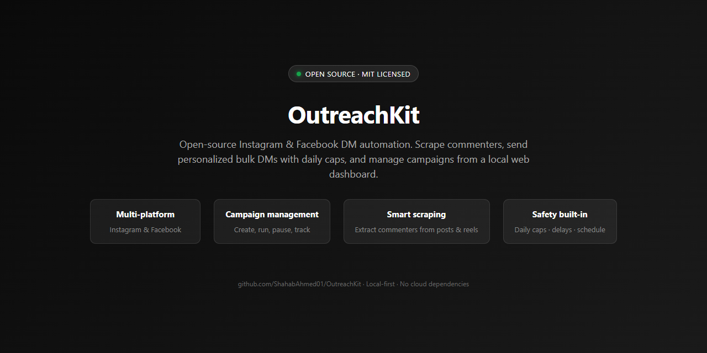
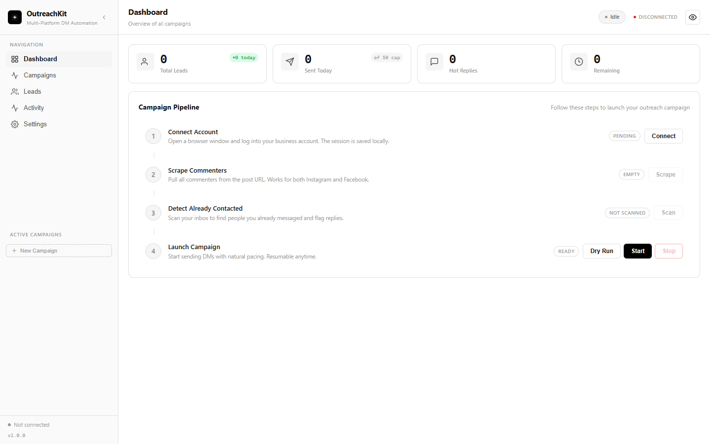
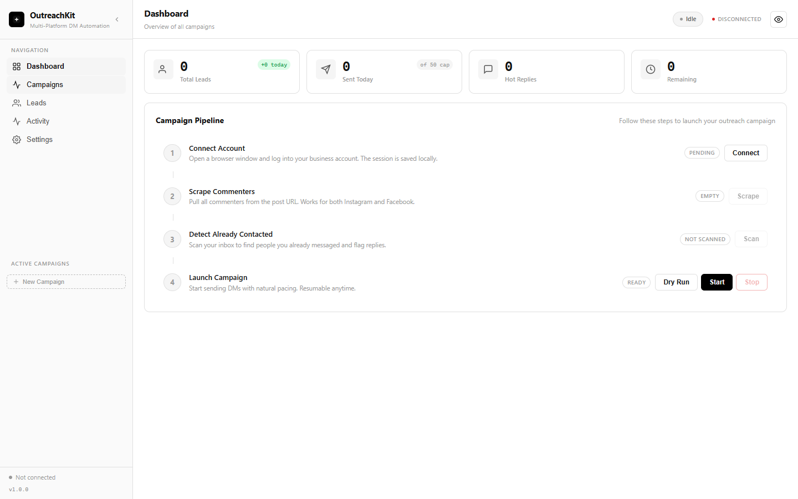
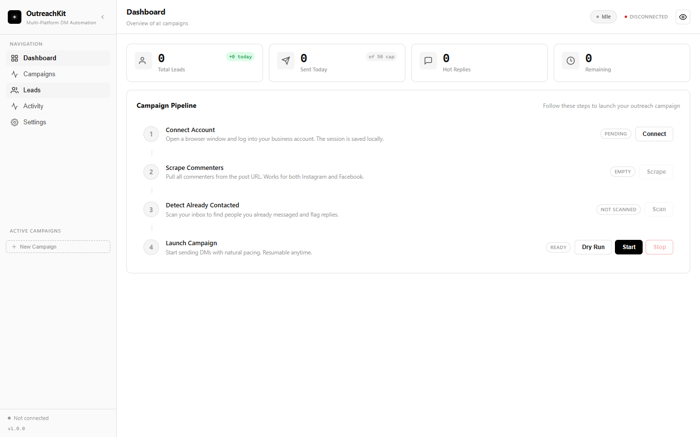
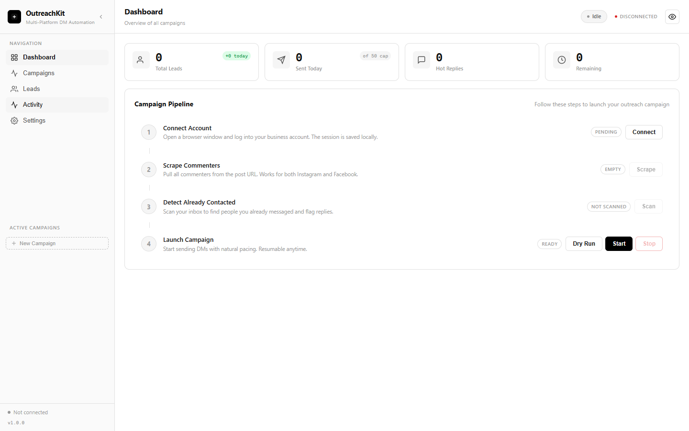
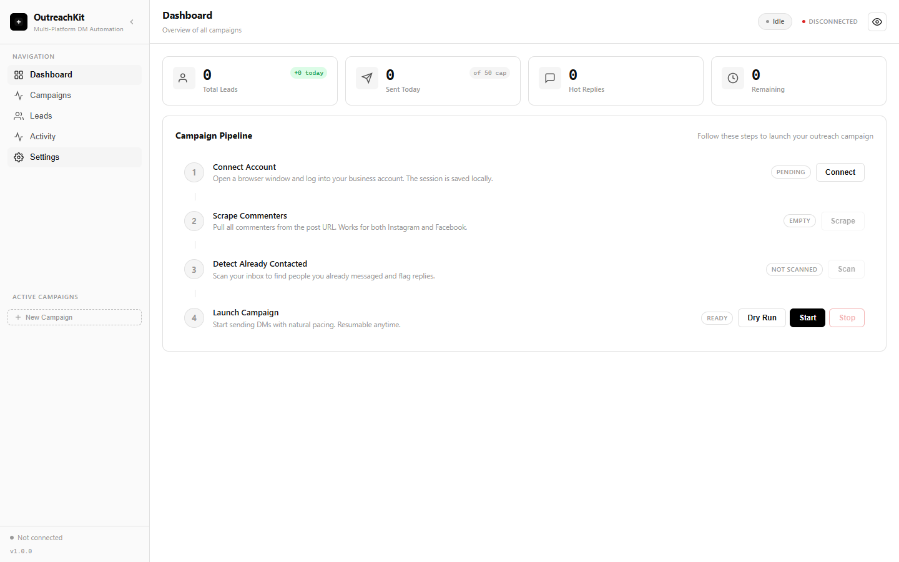
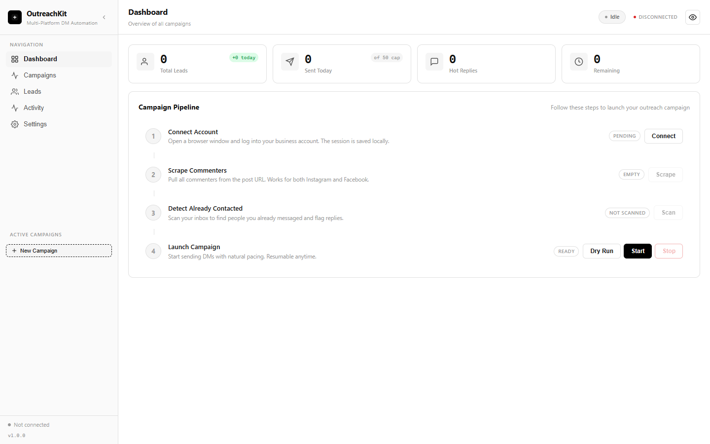

# OutreachKit

Open-source Instagram & Facebook DM automation. Scrape commenters, send personalized bulk DMs with daily caps, campaign management, and a modern web dashboard — all running locally.

[](https://github.com/ShahabAhmed01/OutreachKit/actions/workflows/ci.yml)
[](LICENSE)
[](https://nodejs.org)



## What it does

OutreachKit helps you run DM outreach campaigns on Instagram and Facebook from your own machine:

1. **Connect** — Log into your business account through a local browser window. Your session is saved locally.
2. **Scrape** — Pull commenters from a post or reel URL. Works for Instagram and Facebook.
3. **Detect** — Scan your inbox to find people you already messaged and flag replies.
4. **Launch** — Send personalized DMs with `{username}`, `{comment}`, and `{link}` template variables, daily caps, configurable delays, and schedule windows.

Everything runs locally — your data and session never leave your machine.

## Quick start

```bash
# Clone the repository
git clone https://github.com/ShahabAhmed01/OutreachKit.git
cd OutreachKit

# Install dependencies
npm install

# Install Playwright's Chromium browser
npx playwright install chromium

# Start the dashboard
npm start
```

Open `http://localhost:3000` in your browser.

On Linux, Playwright's Chromium may need extra system libraries:

```bash
npx playwright install-deps chromium   # requires sudo
```

## Features

| Feature | Description |
|---------|-------------|
| Multi-platform | Instagram and Facebook DM automation |
| Campaign management | Create, run, pause, and track multiple campaigns |
| Smart scraping | Extract commenters from posts and reels |
| Personalized outreach | Template variables: `{username}`, `{comment}`, `{link}` |
| Safety built-in | Daily caps, configurable delays, schedule windows, consecutive-failure pauses |
| Comment filtering | Keyword-based targeting for qualified leads |
| Inbox scanning | Auto-detect replies and mark already-contacted users |
| Backup & restore | One-click data backup and restore |
| Modern dashboard | Real-time SSE updates, glassmorphism UI |

## Screenshots

### Dashboard


### Campaigns


### Leads


### Activity log


### Settings


### Campaign wizard


## Configuration

Edit `config.json` in the project root:

```json
{
  "dailyCap": 50,
  "delayMinSec": 60,
  "delayMaxSec": 120,
  "pauseOnConsecutiveFailures": 3,
  "pauseMinutes": 30,
  "messages": {
    "openers": ["Hey {username}, great post!"],
    "questions": ["What do you think about {comment}?"]
  },
  "commentFilter": {
    "enabled": false,
    "keywords": []
  },
  "schedule": {
    "enabled": false,
    "start": "09:00",
    "end": "23:00"
  }
}
```

Settings can also be changed through the dashboard's Settings page.

### Environment variables

| Variable | Default | Description |
|----------|---------|-------------|
| `PORT` | `3000` | Server port |

## Scripts

```bash
npm start          # Start the dashboard
npm test           # Run unit + server tests
npm run test:server # Run server API integration tests
npm run lint       # Lint source files
npm run format     # Format code with Prettier
npm run dist       # Build a distributable package
```

## Architecture

```
src/
├── server.js       # Express HTTP server + API routes
├── config.js       # Config loading and sanitization
├── csv.js          # CSV parsing and writing
├── campaign.js     # Campaign CRUD operations
├── scrape.js       # Instagram/Facebook GraphQL scraping
├── scan-inbox.js   # Inbox scanning for replies
├── send.js         # DM sending logic
├── session.js      # Login/session detection (Playwright)
├── login.js        # Interactive login flow
├── validator.js    # Input validation helpers
├── security.js     # Security helpers (path traversal, sanitize)
├── report.js       # Campaign activity reports
└── utils.js        # Logging, timestamps, sleep helpers
gui/
├── server.js       # Static dashboard file server
├── index.html      # Dashboard HTML
├── app.js          # Frontend JavaScript
└── app.css         # Dashboard styles
```

## Requirements

- Node.js >= 20
- A Chrome, Edge, or Chromium-based browser (for Playwright automation)
- An Instagram or Facebook business account
- Internet access (to reach Instagram/Facebook)

## Limitations

- **Platform terms of service:** Automated messaging may violate Instagram's or Facebook's Terms of Service. Use daily caps, delays, and schedule windows to reduce risk. You are responsible for compliance with platform policies.
- **Session-based:** You must log in through the Connect step before scraping or sending. Sessions can expire; re-connect if you see "SESSION_EXPIRED" errors.
- **Local-first:** Data is stored on your machine in the `data/` directory. Back it up regularly with the built-in backup feature.
- **No cloud component:** There is no hosted version — you run OutreachKit on your own hardware.

## Contributing

See [CONTRIBUTING.md](CONTRIBUTING.md).

## License

MIT © 2026 Shahab Ahmed
